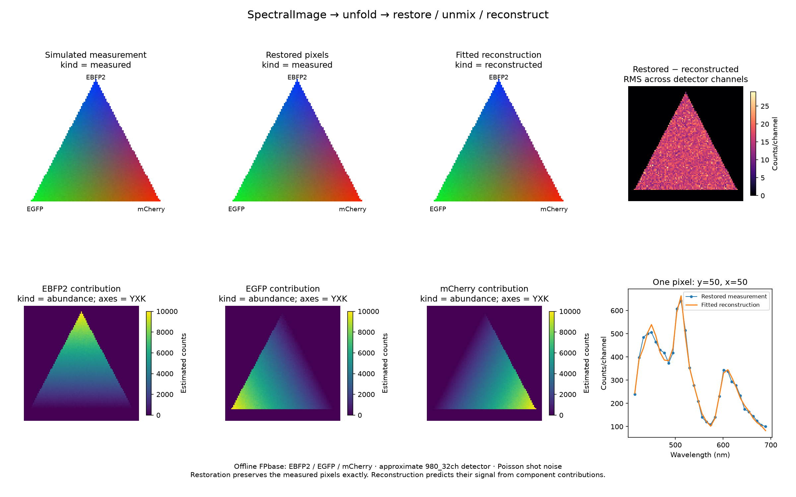

# Lumic

[](https://pypi.org/project/lumic/)
[](https://pypi.org/project/napari-lumic-cci/)
[](https://github.com/CCI-GU-Sweden/lumic/actions/workflows/python-tests.yml)
[](environment.yml)
[](LICENSE)

**Lumic** is a Python toolkit for separating overlapping fluorescence signals
in microscopy images. It estimates how much each spectral component contributes
to each pixel and helps you inspect what the fitted model leaves unexplained.

## Install the published backend

The Lumic backend is available as a prerelease. Install it from
[PyPI](https://pypi.org/project/lumic/0.1.0rc3/) in a Python 3.12 environment:

```bash
python -m pip install "lumic==0.1.0rc3"
```

The [backend quickstart](Python/lumic/README.md#unmix-a-simulated-pixel-offline)
runs with the installed package and its bundled spectra. The full walkthrough
below uses examples and sample data from the repository checkout.

The [documentation source](docs/index.md) includes tutorials on loading
images, estimating spectra, evaluating fits, and saving results. See the
[local preview instructions](CONTRIBUTING.md#preview-the-documentation-locally)
to browse the site.

## Install the published plugin

In a fresh Python 3.12 environment, install the plugin and a Qt binding:

```bash
python -m pip install napari-lumic-cci "napari[pyqt6]"
```

Launch napari with `python -m napari`, then open **Plugins → LUMIC CCI-GU →
Spectral Unmixing**. See the [plugin README](Python/plugin/README.md) and
[plugin documentation](docs/plugins/overview.md) for the workflow.

Start with the simulation below. You do not need microscope data or a notebook:
it creates a small image, separates its three fluorescent proteins, and saves
figures and images for you to inspect. Lumic is under development; the current
setup runs from this repository with Python 3.12.

## 1. Get the repository and set up Python

For a backend-only pip install, use `python -m pip install ./Python/lumic` from the
repository root in a Python 3.12 environment. To run this walkthrough in a
separate pip environment, use `python -m pip install './Python/lumic[examples]'` and then
run the example from the `Python` folder. The Conda setup below includes
the backend development tools and example dependencies.

You need **Git** and **Conda** (for example, Miniforge) installed, and access to
this repository. Open a terminal where both `git` and `conda` are available.
Run these commands one at a time:

```bash
git clone https://github.com/CCI-GU-Sweden/lumic.git
cd lumic
conda env create -f environment.yml
conda activate unmixing-env
cd Python
```

Already have the repository? Open its root folder in your terminal and start
with `conda env create`; skip that command if you already created the current
environment. The environment contains Python and the required packages. Its
initial installation needs an internet connection; the simulation uses bundled
spectra and runs offline afterward.

**Keep the terminal in the `Python` folder for the commands below.**
Use `python -m examples.…` as shown, so Python can find the local `lumic` package.
If you return in a new terminal, activate `unmixing-env` and enter this folder
again. Existing Python 3.9 users can follow the
[environment migration instructions](CONTRIBUTING.md#upgrading-an-existing-python-39-setup).

## 2. Run your first simulation and unmixing example

```bash
python -m examples.spectral_image_workflow
```

This runs the readable [example script](Python/examples/spectral_image_workflow.py).
It:

1. Uses bundled FPbase spectra for **EBFP2, EGFP and mCherry**, sampled through an
   approximate 32-channel ZEISS LSM 980 detector.
2. Creates a triangular image: each corner represents one protein, and the
   interior contains mixtures in different proportions.
3. Adds a small amount of random photon-counting noise to mimic a measurement.
4. Unmixes each pixel using the known reference spectra, estimating the
   contribution of each protein. These contribution images are **abundance maps**.
5. Recombines the estimated contributions and spectra to predict the detector
   signal. This is the **reconstructed image**. The difference from the simulated
   measurement is the **residual**.
6. Saves and reloads the measurement, reconstruction and abundance maps as
   OME-TIFF, checking that pixels are preserved. It also recreates the fitted
   signal using only the reloaded abundance maps and their saved spectra.

This first example supplies the reference spectra. Discovering unknown spectra
from the image with convex-hull selection and MCR-ALS is a separate workflow;
a good reconstruction alone does not prove that the recovered components are unique.

## 3. Open and understand the results

Open this PNG in your file browser, relative to the repository root:

**[`Python/data/visual-check-spectral-image-workflow.png`](Python/data/visual-check-spectral-image-workflow.png)**



- **Simulated measurement:** an RGB preview of the 32-channel image. These display
  colors help you view the mixture; they are not the unmixing result.
- **Restored pixels:** the same measurement after converting it into a matrix of
  pixel spectra and back into an image. It should look identical.
- **Fitted reconstruction:** the signal predicted by the fitted contributions.
- **Residual map:** where the measurement differs from that prediction, summarized
  across detector channels. Some residual is expected because we added noise.
- **Three contribution maps:** the estimated counts from each protein at each pixel.
- **One-pixel spectrum:** measured and predicted signals plotted across wavelengths.

The exported images are saved in
**`Python/examples/output/spectral-image-workflow/`**:

| File | What it contains |
| --- | --- |
| `measured.ome.tif` | Simulated detector measurement, including noise |
| `reconstructed.ome.tif` | Fitted detector signal |
| `abundances.ome.tif` | Three component maps, with the paired spectra in Lumic metadata |

The script prints its output paths and stops with an error if a round-trip
check fails. These files use lossless compression. Running it again replaces
this example's outputs. OME viewers can read the component maps as named
channels; recovering the saved spectral basis requires understanding the Lumic
annotation, as Lumic's reader does.

## 4. Try a small change

Open [spectral_image_workflow.py](Python/examples/spectral_image_workflow.py)
and edit the settings at the top, then run the same command again:

- Set `ADD_SHOT_NOISE = False`. The reconstruction should now almost exactly
  match the measurement, and the residual should be near numerical precision.
- Set it back to `True` and reduce `TOTAL_COUNTS` from `10000.0` to `1000.0`.
  Relative noise increases when fewer photons are detected; compare how clearly
  you can recover the protein contributions. The residual plot chooses its own
  scale on each run, so read the color-bar values when comparing images.
- Change `FLUOROPHORES` to another set of **three distinct** names from
  `EBFP2`, `EGFP`, `mCherry`, `mNeptune`.

`SEED` makes the random noise repeatable when rerunning the same settings.
The current example replaces its previous figure, so copy it first if you want
side-by-side comparisons.

## Next: use your own data or explore further

- **Find a runnable example:** see the [examples guide](Python/examples/README.md).
- **Load CZI or OME-TIFF:** the [image I/O guide](Python/lumic/IO_README.md)
  explains inspection, loading, axis labels, metadata and saving results.
  [load_spectral_image.py](Python/examples/load_spectral_image.py) is a small
  starting example that downloads the public COS-7 CZI by default.
- **Discover spectra from an image:** the
  [COS-7 workflow](docs/backend/cos7-workflow.md) and its
  [minimal notebook](Python/examples/notebooks/minimal_example.ipynb) demonstrate spectral
  selection, MCR-ALS refinement and unmixing. It downloads the public high-SNR
  COS-7 acquisition by default. To use your data, set the input path and choose
  reference pixels for your image.
- **Explore spatial mixtures and noise:** see the
  [simulation building blocks](Python/lumic/simulation/README.md),
  [evaluation examples](Python/evaluations/README.md), and
  [spectral uniqueness maps](docs/backend/spectral-uniqueness-maps.md).
- **Find bundled data and attribution:** see the [data index](Python/data/README.md)
  and [offline FPbase spectra](Python/lumic/simulation/fpbase_data/README.md).

## Run the tests or contribute

With the environment active and your terminal in `Python/`:

```bash
python -m pytest --ignore-glob="tests/test_plugin_*.py"
```

Plugin tests require the plugin dependencies and a Qt binding; see the
[plugin README](Python/plugin/README.md). The tests run offline. GitHub Actions also runs them for pull requests targeting
`main` and pushes to `main`. See [CONTRIBUTING.md](CONTRIBUTING.md) for the
contribution workflow, environment details and GitHub check settings.

## Acknowledgements

We thank **Raffaele Vitale (University of Lille)** for valuable scientific
discussions and insights that helped guide Lumic's development, and for sharing
a MATLAB implementation that served as a basis for parts of the Lumic backend.
That MATLAB implementation is not distributed in this repository.

## License and data attribution

Lumic code and documentation are distributed under the [MIT license](LICENSE).
The microscopy I/O fixtures supplied by Centre for Cellular Imaging (CCI),
Gothenburg, are dedicated under [CC0 1.0 Universal](Python/data/io-data/LICENSE.md).
The bundled [FPbase spectra](Python/lumic/simulation/fpbase_data/README.md) retain
their separate source-policy and attribution notice. See the
[data index](Python/data/README.md) for provenance and details.
