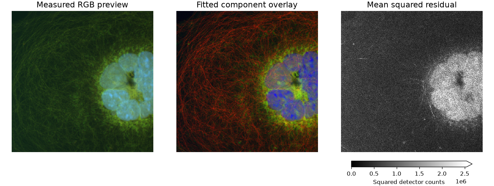

# Unmix a real experimental image (COS-7)

Use this notebook to unmix a spectral confocal image from the public COS-7
dataset. First fit the image with spectra selected from individual pixels.
Then estimate starting spectra from the convex hull, refine them with
MCR-ALS, and inspect the resulting abundance maps and reconstruction error.

## Run your first notebook

1. **Download the notebook.** Save [`minimal_example.ipynb`](minimal_example.ipynb){: download="minimal_example.ipynb" }
   in a folder where you also want the output TIFFs.
2. **Create a Python 3.12 environment.** If you don't already have Conda,
   [install Miniforge](https://conda-forge.org/download/), the conda-forge
   installer. Open a new terminal on macOS or Linux, or **Miniforge Prompt**
   on Windows. Use `cd` to go to the folder containing the notebook, then
   run these commands one at a time.

    ```bash
    conda create -n lumic-notebooks -c conda-forge python=3.12 pip
    conda activate lumic-notebooks
    ```

3. **Install Lumic and start JupyterLab.** The `examples` extra includes
   JupyterLab and the notebook dependencies. Run both commands in the same
   terminal with `lumic-notebooks` active.

    ```bash
    python -m pip install "lumic[examples]==0.1.0"
    jupyter lab
    ```

4. **Open and run the notebook.** JupyterLab opens in your browser. Double-click
   `minimal_example.ipynb` in the file browser on the left. If asked to choose
   a kernel, select **Python 3 (ipykernel)** from this environment. The kernel
   is the Python process that runs the notebook. Select the first cell and
   press **Shift + Enter** to run it and move to the next, or use
   **Run → Run All Cells** to run the notebook from top to bottom.

The first run downloads the high-SNR mixed CZI (about 145 MB), and later runs
reuse it. To use your own acquisition, change `IMAGE_PATH` and choose reference
pixels for that image.
[BioImage Archive S-BIAD4448](https://www.ebi.ac.uk/biostudies/bioimages/studies/S-BIAD4448)



The detector preview groups the measured channels into RGB. The fitted overlay
shows three selected abundance maps from the four-component blind fit.
The error map shows the mean squared residual per pixel. Its display scale
ends at the 99th percentile so the brightest pixels do not obscure smaller
errors. See [Evaluate experimental data](evaluate-results.md) for ways to
investigate these residuals.
