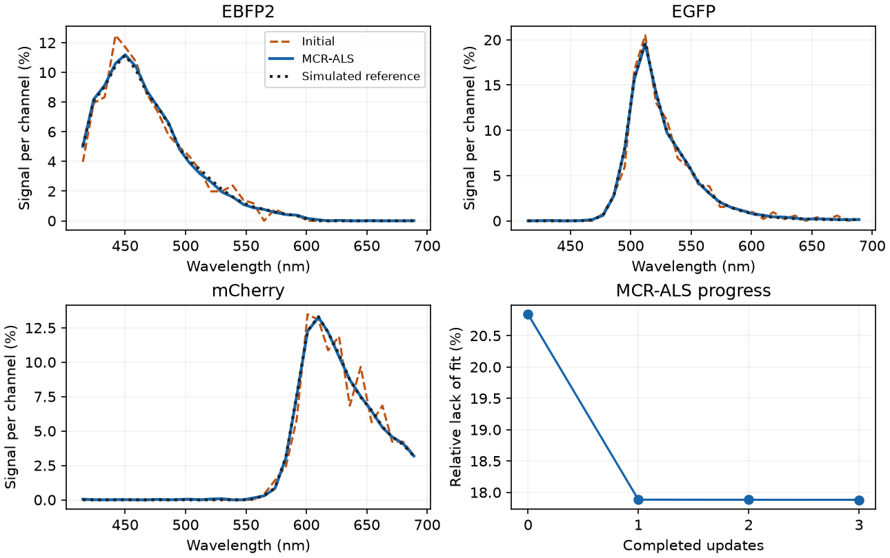
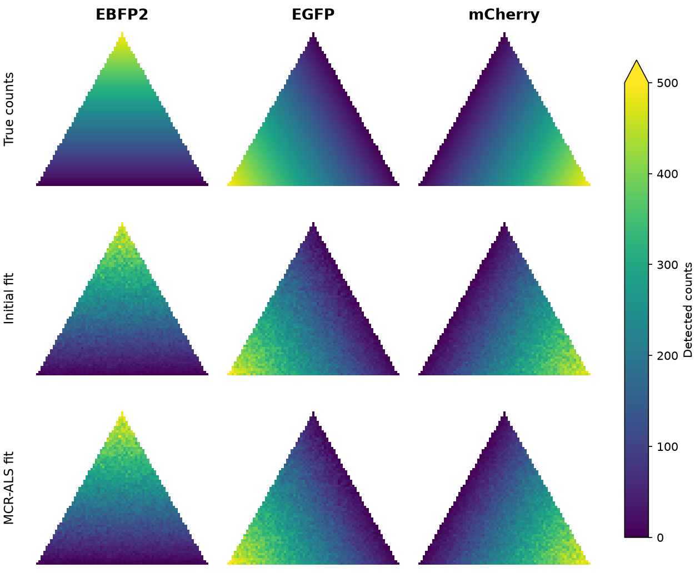

# Estimate unknown spectra

Use the same noisy [ternary image](unmix-ternary-image.md#simulate-the-triangle),
this time supplying only the image and an expected component count of three.
First select three starting spectra directly from the image and use them to
estimate the component maps. Then refine the spectra with multivariate curve
resolution by alternating least squares (MCR-ALS).

Run the blocks below in order using the environment from the
[quickstart](quickstart.md).

For an explanation of the selection method and its limitations, see
[Convex hull selection](convex-hull.md).

## Simulate the input image

Build a triangle with pure EBFP2 at the top, EGFP at the bottom left, and
mCherry at the bottom right. Inside the triangle, each pixel has 500 expected
counts across all detector channels. Add shot noise to create the image the
unmixing workflow will receive. The reference spectra and true component
maps are kept for the final comparison.

```python
import numpy as np

from lumic.simulation import (
    SpectralDetector,
    add_confocal_noise,
    load_offline_emission_spectrum,
    simulate_linear_mixture,
)

names = ("EBFP2", "EGFP", "mCherry")
detector = SpectralDetector.from_profile("980_32ch")
spectra = np.array([
    detector.sample(*load_offline_emission_spectrum(name))
    for name in names
])
spectra /= spectra.sum(axis=1, keepdims=True)

size = 81
total_counts = 500.0
y, x = np.indices((size, size), dtype=float)

# Use vertices (x, y) of (40, 4), (4, 68), and (76, 68).
blue = (68 - y) / 64
red = (x - 4 - 36 * blue) / 72
green = 1 - blue - red
fractions = np.stack((blue, green, red), axis=-1)
inside = np.all(fractions >= -1e-12, axis=-1)
true_counts = total_counts * np.where(
    inside[..., None], np.clip(fractions, 0, 1), 0,
)

simulation = simulate_linear_mixture(
    true_counts, spectra, detector.channel_centers, fluorophore_names=names,
)
noisy = add_confocal_noise(simulation.image, rng=np.random.default_rng(2026))
```

## Estimate spectra directly from the image

Unfold the image into one row per pixel. For this simulation, the background
outside the triangle is exactly zero, so we exclude zero-signal pixels from
spectral estimation. The convex hull selects candidates at the extremes of
a low-dimensional spectral projection. `unique_profiles` selects three
spectra from that candidate set. The selection uses the measured spectra
without needing the triangle coordinates or the simulated references.

```python
from lumic import SpectralImage, essential_spectral_pixles, unique_profiles

n_components = 3
image = SpectralImage(data=noisy, axes="YXC", wavelengths_nm=detector.channel_centers)
unfolded = image.unfold()
pixels = unfolded.data
signal_pixels = pixels[pixels.sum(axis=1) > 0]

hull_spectra, _ = essential_spectral_pixles(signal_pixels, npc=n_components)
initial_spectra, _ = unique_profiles(hull_spectra.T, nr=n_components, f=1.0)
initial_spectra = initial_spectra / initial_spectra.sum(axis=1, keepdims=True)
print(f"Selected {n_components} starting spectra from {len(hull_spectra)} candidates")
```

The three starting spectra are individual noisy pixel spectra. Normalize each
to sum to one across the detector channels so its fitted contribution is in
counts. Use nonnegative least squares to estimate those contributions for
every pixel with the spectra held fixed.

```python
from lumic import positive_least_squares

initial_counts = positive_least_squares(pixels, initial_spectra, solver="auto")
initial_maps = unfolded.fold_abundances(initial_counts)
```

## Refine the spectra with MCR-ALS

MCR-ALS alternates between fitting component contributions and updating
the spectra. The hull supplies the starting spectra. For this small example,
we use all signal pixels during refinement so mixtures inside the triangle
also contribute. We allow up to 200 updates and set a stopping tolerance
of 0.01% relative improvement per update.

```python
from lumic import mcr_als

_, refined_spectra, history, diagnostics = mcr_als(
    signal_pixels, initial_spectra, nIter=200, normL="L1",
    tol_percent=0.01, return_diagnostics=True,
)
refined_counts = positive_least_squares(pixels, refined_spectra, solver="auto")
refined_maps = unfolded.fold_abundances(refined_counts)
print(f"{diagnostics.iterations_completed} updates ({diagnostics.stop_reason})")
print(f"Relative lack of fit: {history[0]:.1%} → {diagnostics.best_relative_l2:.1%}")
```

With the tutorial's noise seed, the solver converges in three updates and
the relative lack of fit drops from 20.8% to 17.9%. This measure is the norm
of the reconstruction residual divided by the norm of the measured signal.

## Compare with the known simulation

The fit can return components in any order. For this comparison only, use
`match_components` to pair each recovered spectral shape with a simulated
reference. Apply the same ordering to the maps.

```python
from lumic.evaluation import match_components

initial_order, _ = match_components(spectra, initial_spectra)
refined_order, _ = match_components(spectra, refined_spectra)

for stage, basis, maps, order in (
    ("Initial", initial_spectra, initial_maps, initial_order),
    ("Refined", refined_spectra, refined_maps, refined_order),
):
    channel_error = 100 * np.abs(basis[order] - spectra)
    count_error = np.abs(maps.data[..., order] - true_counts)
    print(stage)
    for index, name in enumerate(names):
        print(
            f"  {name}: mean channel error {channel_error[index].mean():.3f} pp, "
            f"largest channel error {channel_error[index].max():.3f} pp, "
            f"mean map error {count_error[inside, index].mean():.1f} counts"
        )
```



Each spectrum is expressed as a percentage of its total signal. Channel
errors are differences on that scale in percentage points (pp). The
largest channel error falls from about 2 percentage points for each
component to below 0.3 after refinement.



The component maps already look similar after the initial fit. Refinement
improves their mean absolute error by less than one count per component, even
though the spectra improve visibly.

See [Recover a spectrum without pure pixels](recover-hidden-spectrum.md) for a
mixture where EGFP always appears alongside another fluorophore.

Use the fitted image to [inspect reconstruction errors](evaluate-results.md)
or [measure simulation recovery](evaluate-simulation-recovery.md).
