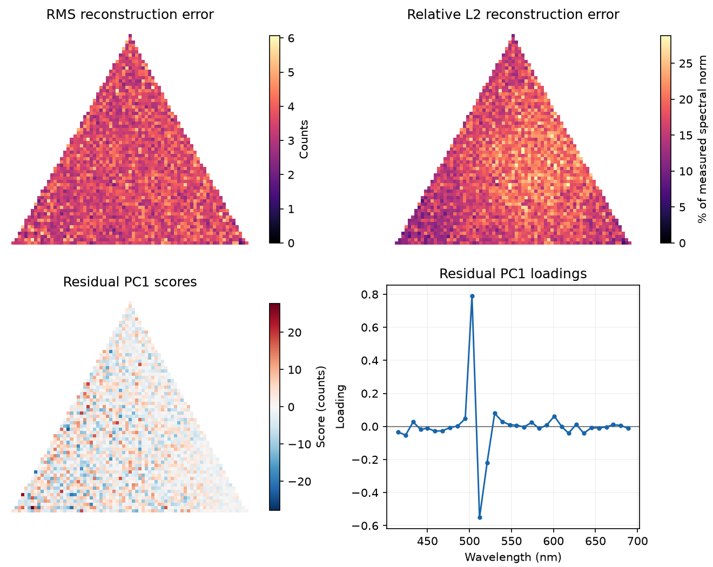
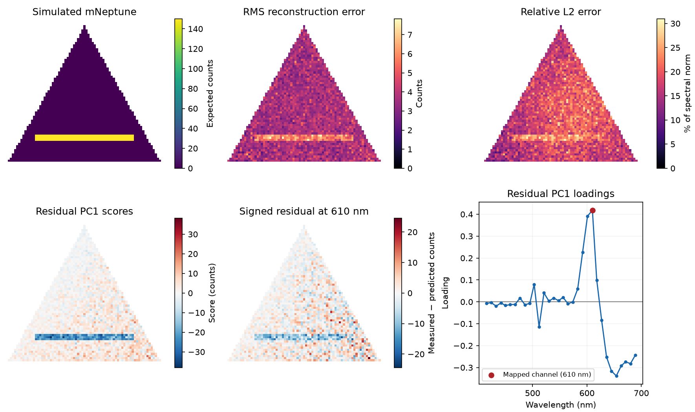

# Evaluate experimental data

Use the measured image and the fitted spectra and abundances to see where
unmixing leaves signal unexplained. These diagnostics work without knowing
which components are present or how much of each is in a pixel.

To reproduce the plots, run [Estimate unknown spectra](estimate-unknown-spectra.md)
through **Refine the spectra with MCR-ALS**. The walkthrough uses the simulated
mixture as a stand-in for an experimental image. Its ground truth is excluded
from the calculations below. For your own data, use the unfolded measured
image and its paired fitted abundances and spectra.

## Map reconstruction errors

Multiply the fitted abundances by their spectra to predict the detector
signal at every pixel. Fold the prediction back into the image. This example
uses `YXC` arrays, with the detector channel axis last as required by
`reconstruction_error_maps`.

```python
from lumic.evaluation import reconstruction_error_maps

observed = unfolded.fold_spectra().data
reconstructed = unfolded.fold_spectra(refined_counts @ refined_spectra).data
errors = reconstruction_error_maps(observed, reconstructed)
```

- **Signed residuals** (`errors.residuals`) are measured minus predicted
  signal, one value per pixel and channel. Positive values show where the
  model predicted too little signal.
- **RMS error** (`errors.rms`) gives the size of the residual across channels,
  in detector intensity units. Use it to locate large mismatches. Shot noise
  can produce larger absolute errors in bright regions.
- **Relative L2 error** (`errors.relative_l2`) divides each pixel's residual
  norm by its measured spectral norm. Use it to compare mismatch relative to
  signal strength. It can be unstable near zero signal. Set `min_signal` to a
  threshold appropriate for your data and use `errors.relative_valid` to
  mask excluded pixels.

## Look for structure in the residuals

A single RMS value per pixel hides which channels account for the mismatch.
Residual PCA finds patterns across the signed channel residuals. Plot each
PC's loadings against detector wavelength and its scores as an image.
Spatially coherent scores can point to a region worth inspecting.

```python
from lumic.evaluation import (
    residual_neighbor_correlation,
    residual_pca_from_residuals,
    residual_spectral_correlation,
)

pca = residual_pca_from_residuals(errors.residuals, n_components=3)
pc1_map = pca.scores[..., 0]
pc1_spectrum = pca.loadings[0]
mean_residual = pca.mean_residual
print(f"PC1 explains {pca.explained_variance_ratio[0]:.1%} of centered residual variance")

neighbor_correlation = residual_neighbor_correlation(errors.residuals)
channel_correlation_map = residual_spectral_correlation(errors.residuals)
print(f"Residual neighbor correlation: {neighbor_correlation:.3f}")
```

Inspect the mean residual for persistent channel bias that centered PCA
removes. Neighbor correlation summarizes how similarly adjacent pixels
behave across the image. Spectral correlation maps how similarly adjacent
channels behave at each pixel. Inspect these alongside the error magnitude.
Noise, fitting, detector artifacts, or a missing spectral component can
all create structure. Use the diagnostics to guide inspection. They do
not identify a fluorophore or establish statistical significance.



The maps show the signal region from the example. The PC1 score map and
loading curve describe the same pattern in space and across channels.

## Compare two fits without ground truth

Pass two sets of fitted spectra to `compare_spectra` to see how much each
spectral shape changes. By default it pairs the components before comparing
them. You can use this to check sensitivity to initialization or pixel
selection. Stability across runs describes agreement between estimates.

```python
from lumic.evaluation import compare_spectra

change = compare_spectra(initial_spectra, refined_spectra)
print("Spectral shape distances:", change.shape_distance)
print("Largest channel changes (percentage points):", 100 * change.max_channel_change)
```

`shape_distance` compares unit-L2 spectral shapes.
`max_channel_change` compares the fraction of total signal assigned to a
single channel after scaling each spectrum to sum to one.

If you have known spectra and abundance maps, you can
[evaluate recovery against simulation ground truth](evaluate-simulation-recovery.md).

## What does a missing component look like?

Add a narrow line of mNeptune to the noisy ternary example. The line
contributes 150 expected counts per pixel on top of the original 500.
Fit the resulting image with three components using the same blind
workflow. The fit receives the measured pixels and the component count.
The true location of the fourth fluorophore is shown in the figure for
comparison.

```python
from lumic import SpectralImage, essential_spectral_pixles, mcr_als
from lumic import positive_least_squares, unique_profiles
from lumic.simulation import (
    add_confocal_noise, load_offline_emission_spectrum, simulate_linear_mixture,
)

mneptune = detector.sample(*load_offline_emission_spectrum("mNeptune"))
mneptune = mneptune / mneptune.sum()
line = inside & (np.abs(y - 57) <= 1) & (x >= 17) & (x <= 63)
line_counts = 150.0 * line
four_counts = np.concatenate((true_counts, line_counts[..., None]), axis=-1)
four_spectra = np.vstack((spectra, mneptune))
four_component_scene = simulate_linear_mixture(
    four_counts, four_spectra, detector.channel_centers,
)
measured = add_confocal_noise(
    four_component_scene.image, rng=np.random.default_rng(2026),
)
```

```python
omitted_fit = SpectralImage(data=measured, axes="YXC").unfold()
pixels = omitted_fit.data
signal_pixels = pixels[pixels.sum(axis=1) > 0]

assumed_components = 3
hull, _ = essential_spectral_pixles(signal_pixels, npc=assumed_components)
starts, _ = unique_profiles(hull.T, nr=assumed_components, f=1.0)
_, fit_spectra, _, fit_info = mcr_als(
    signal_pixels, starts, nIter=200, normL="L1",
    tol_percent=0.01, return_diagnostics=True,
)
fit_counts = positive_least_squares(pixels, fit_spectra, solver="auto")
predicted = omitted_fit.fold_spectra(fit_counts @ fit_spectra).data
omitted_errors = reconstruction_error_maps(measured, predicted)
omitted_pca = residual_pca_from_residuals(omitted_errors.residuals, n_components=3)
print(f"Relative lack of fit: {fit_info.best_relative_l2:.1%}")
```



The overall lack of fit is **18.6%**, close to the **17.9%** in the original
three-component example. The maps show a clearer difference. The line has
higher RMS error than the surrounding mixture, and it stands out in the
first residual PC score map. The loading curve shows where that pattern
varies across wavelengths. The signed residual panel shows measured minus
predicted signal at the channel with the largest absolute PC1 loading.
At that channel, the model overpredicts signal along the line as it tries
to fit the mixture with three components.

On experimental data, a coherent feature like this gives you a region to
inspect and a reason to try another fit. The PC loading is a pattern in
the unexplained signal. Its shape alone cannot identify the fluorophore
or determine how many components to add.

The repository's `Python/evaluations/evaluate_dim_line_recovery.py` explores
the same diagnostic idea with bright spokes, a dim mNeptune line, a broad
background, and several blur levels. It also compares four- and five-component
fits to test whether adding a component helps recover the line.
