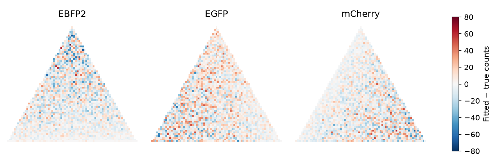

# Evaluate simulation recovery

A simulation gives you the true spectra and abundance maps. Compare them
with the fitted spectra and maps to measure how much of each component the
fit recovered.

Run [Estimate unknown spectra](estimate-unknown-spectra.md) through
**Refine the spectra with MCR-ALS** to create the ternary image and the
abundance estimates used here.

## Compare fitted factors with ground truth

In the simulation we know the true spectra and abundance maps.
`concentration_error_maps` matches component order and brings the factors
to the same scale before subtracting truth from the estimates.
`evaluate_factors` summarizes recovery over the pixels you pass in.
Here we use the triangle mask so empty background does not dilute the
abundance RMSE.

```python
from lumic.evaluation import concentration_error_maps, evaluate_factors

recovery_maps = concentration_error_maps(
    true_counts, spectra, refined_maps.data, refined_spectra,
)
recovery = evaluate_factors(
    image.data[inside], true_counts[inside], spectra,
    refined_maps.data[inside], refined_spectra,
)
for name, shape_error, rmse in zip(
    names, recovery.spectral_relative_l2_per_component, recovery.abundance_rmse_per_component,
):
    print(f"{name}: spectral shape distance {shape_error:.3f}, abundance RMSE {rmse:.1f} counts")
```

The spectral shape distance compares spectra after scaling each to unit L2
norm. The abundance RMSE here is in detected counts. For an individual
component, the signed map shows overestimation and underestimation, and the
absolute map also shows false positives where the true abundance is zero.
Relative abundance error is only defined where the true abundance exceeds
the threshold.



Red shows overestimation and blue shows underestimation. The shared color
scale makes the size of the error comparable across components.

For a separate check of how closely the model predicts the detector
signal, see [Evaluate experimental data](evaluate-results.md). The
reconstruction diagnostics there also apply to simulations.
