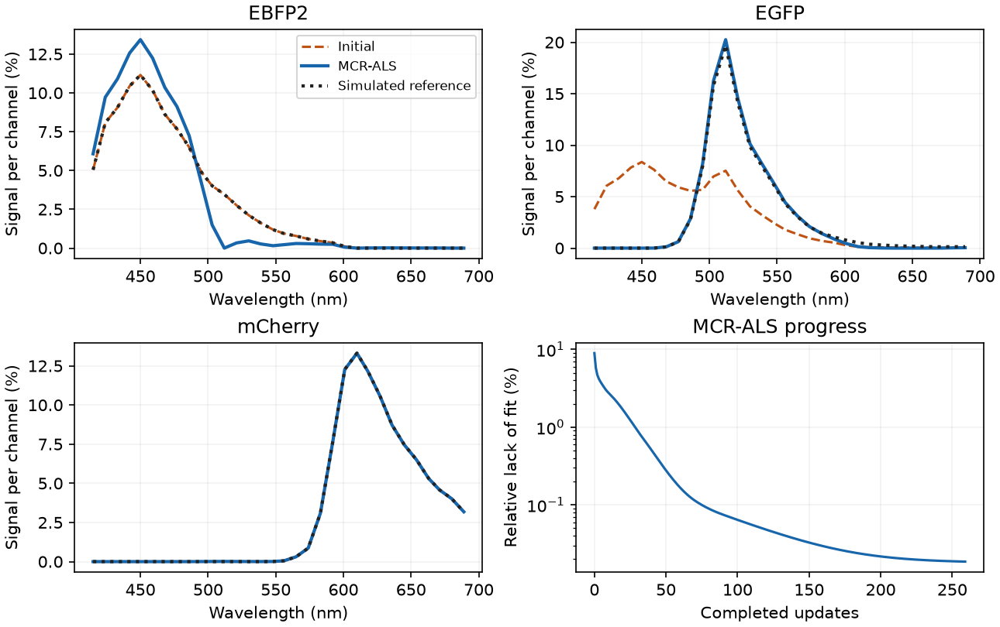

# Recover a spectrum without pure pixels

Can MCR-ALS estimate a fluorophore's spectrum when it always appears in a
mixture? This example simulates that situation for EGFP and compares the
initial and refined spectra. The fit receives the simulated image and a
component count of three. The reference spectra are used to create the image
and evaluate the result.

Run the blocks below in order using the environment from the
[quickstart](quickstart.md). For an introduction to the workflow, see
[Estimate unknown spectra](estimate-unknown-spectra.md).

## Simulate a mixture with no pure EGFP pixel

From bottom to top, the EGFP fraction rises from 0% to 25%. At every row, the remaining counts
shift from EBFP2 on the left to mCherry on the right. The two bottom corners
still have pure EBFP2 and pure mCherry, but each pixel with EGFP also contains
at least one other fluorophore. Leave out shot noise for this run to isolate
the effect of missing the pure EGFP pixel.

```python
import numpy as np

from lumic import SpectralImage
from lumic.simulation import (
    SpectralDetector,
    load_offline_emission_spectrum,
    simulate_linear_mixture,
)

names = ("EBFP2", "EGFP", "mCherry")
detector = SpectralDetector.from_profile("980_32ch")
spectra = np.array([
    detector.sample(*load_offline_emission_spectrum(name))
    for name in names
])
spectra /= spectra.sum(axis=1, keepdims=True)

row, col = np.indices((20, 20), dtype=float) / 19
egfp_fraction = 0.25 * (1 - row)
remaining = 1 - egfp_fraction
hidden_true_counts = 1000 * np.stack(
    (remaining * (1 - col), egfp_fraction, remaining * col), axis=-1,
)
hidden_simulation = simulate_linear_mixture(
    hidden_true_counts, spectra, detector.channel_centers, fluorophore_names=names,
)
hidden_image = SpectralImage(data=hidden_simulation.image, axes="YXC")
hidden_pixels = hidden_image.unfold().data
```

## Estimate and refine the spectra

Select three starting spectra from the convex hull of the measured pixel
spectra. MCR-ALS then refines those starting spectra using all 400 pixels.

```python
from lumic import essential_spectral_pixles, mcr_als, unique_profiles

n_components = 3
hidden_hull, _ = essential_spectral_pixles(hidden_pixels, npc=n_components)
hidden_initial, _ = unique_profiles(hidden_hull.T, nr=n_components, f=0.5)
hidden_initial = hidden_initial / hidden_initial.sum(axis=1, keepdims=True)

_, hidden_refined, hidden_history, hidden_diagnostics = mcr_als(
    hidden_pixels, hidden_initial, nIter=500, normL="L1",
    tol_percent=0.1, return_diagnostics=True,
)
print(f"{hidden_diagnostics.iterations_completed} updates ({hidden_diagnostics.stop_reason})")
```

## Compare with the simulation

Match both sets of spectra to the known references for evaluation. The
relative L2 spectral error measures the overall difference across channels,
divided by the L2 norm of the simulated spectrum. It gives a percentage
for each component.

```python
from lumic.evaluation import match_components

hidden_initial_order, _ = match_components(spectra, hidden_initial)
hidden_refined_order, _ = match_components(spectra, hidden_refined)
reference_norm = np.linalg.norm(spectra, axis=1)
for stage, basis in (
    ("Initial", hidden_initial[hidden_initial_order]),
    ("Refined", hidden_refined[hidden_refined_order]),
):
    relative_error = np.linalg.norm(basis - spectra, axis=1) / reference_norm
    print(stage, dict(zip(names, [f"{value:.1%}" for value in relative_error])))
```



In this run, MCR-ALS converges after 259 updates and the EGFP spectral error
drops from **81% to 3.7%**.
At the same time, the EBFP2 spectral error rises from near zero to about
**28%**, as its refined spectrum picks up a feature near the EGFP peak.

MCR-ALS can recover a close approximation of a spectrum even when every
pixel containing it is mixed. The result depends on the mixtures in the
image, the starting spectra, and the noise. Several sets of spectra and
abundance maps can explain the same data, so a small reconstruction error
alone cannot establish that the recovered components are accurate or unique.
