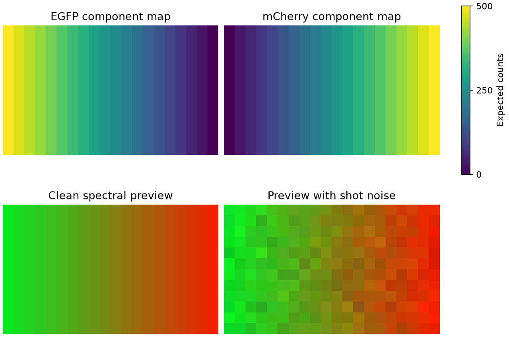

# Simulate a spectral image

The [quickstart](quickstart.md) mixes two reference spectra at one pixel. Here
we build a small image by varying the mixture from left to right. The known
component maps give us a reference for checking what an unmixing method
recovers.

## Create a mixture gradient

Run this example with the installed Lumic backend. It uses bundled FPbase
spectra and the approximate 32-channel LSM 980 detector model.

```python
import numpy as np

from lumic.simulation import (
    SpectralDetector,
    load_offline_emission_spectrum,
    simulate_linear_mixture,
)

names = ("EGFP", "mCherry")
detector = SpectralDetector.from_profile("980_32ch")
spectra = np.array([
    detector.sample(*load_offline_emission_spectrum(name))
    for name in names
])
spectra /= spectra.sum(axis=1, keepdims=True)

# Keep the total at 500 expected counts per pixel. Vary the proportions
# from pure EGFP on the left to pure mCherry on the right.
height, width = 12, 20
total_counts = 500.0
red_fraction = np.linspace(0, 1, width)
counts = np.empty((height, width, len(names)))
counts[..., 0] = total_counts * (1 - red_fraction)
counts[..., 1] = total_counts * red_fraction

simulation = simulate_linear_mixture(
    counts, spectra, detector.channel_centers, fluorophore_names=names,
)

print("Spectral image:", simulation.image.shape)
print("Component maps:", simulation.abundances.shape)
```

The spectral image has shape `(12, 20, 32)` in **Y, X, detector channel**
order. The component maps have shape `(12, 20, 2)` in **Y, X, component**
order. At each pixel, the simulator multiplies the contribution of each
fluorophore by its spectrum and adds the two signals. Because each reference
spectrum sums to one across its channels, the noiseless detector signal
adds up to 500 expected counts per pixel.

## Add shot noise

To simulate one noisy acquisition, continue with this block. The seeded random
generator gives repeatable results, and the original simulation still holds
the clean image and its ground truth.

```python
from lumic.simulation import add_confocal_noise

noisy = add_confocal_noise(simulation.image, rng=np.random.default_rng(2026))
print("Noisy spectral image:", noisy.shape)
```

The noisy image has the same shape, but the total counts per pixel now
fluctuate around 500. Try setting `total_counts = 50.0` and
rerun the example to explore the effect of fewer counts.



The top row shows the known component maps on a shared 0–500 count scale.
The bottom row shows the clean and noisy detector images as RGB previews
with the same display scaling. Lumic combines detector channels to produce
the preview colors.

Next, [unmix a ternary image](unmix-ternary-image.md) and compare the fitted
component maps with the known mixture.
