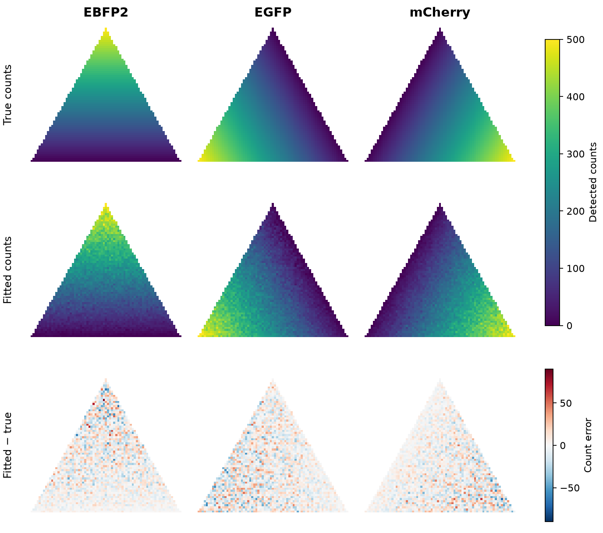

# Unmix a ternary image

This example extends the [two-component simulation](simulate-image.md) to
three fluorophores. Each corner of the triangle contains one pure component.
Along each edge, two components mix. Inside the triangle, all three contribute.
We add shot noise and use the three known reference spectra to estimate how
many counts each fluorophore contributed at each pixel.

Run the blocks in order using the environment from the [quickstart](quickstart.md).
The FPbase spectra are bundled with Lumic, so the example runs offline.

## Simulate the triangle

EBFP2 occupies the top corner, EGFP the bottom left, and mCherry the bottom
right. The fractions sum to one inside the triangle, giving every pixel there
the same total of 500 expected counts. Pixels outside the triangle have zero
signal.

```python
import numpy as np

from lumic.simulation import (
    SpectralDetector,
    add_confocal_noise,
    load_offline_emission_spectrum,
    simulate_linear_mixture,
)

names = ("EBFP2", "EGFP", "mCherry")
detector = SpectralDetector.from_profile("980_32ch")
spectra = np.array([
    detector.sample(*load_offline_emission_spectrum(name))
    for name in names
])
spectra /= spectra.sum(axis=1, keepdims=True)

size = 81
total_counts = 500.0
y, x = np.indices((size, size), dtype=float)

# Use vertices (x, y) of (40, 4), (4, 68), and (76, 68).
blue = (68 - y) / 64
red = (x - 4 - 36 * blue) / 72
green = 1 - blue - red
fractions = np.stack((blue, green, red), axis=-1)
inside = np.all(fractions >= -1e-12, axis=-1)
true_counts = total_counts * np.where(
    inside[..., None], np.clip(fractions, 0, 1), 0,
)

simulation = simulate_linear_mixture(
    true_counts, spectra, detector.channel_centers, fluorophore_names=names,
)
noisy = add_confocal_noise(simulation.image, rng=np.random.default_rng(2026))
```

## Fit the component maps

`SpectralImage.unfold()` puts one pixel on each row of the input matrix.
The nonnegative least-squares fit estimates one contribution per spectrum at
each pixel. The spectra already sum to one, so we preserve their scale to
interpret the estimates as detected counts. Folding restores the spatial
layout. Its `K` axis holds the three fitted components.

```python
from lumic import SpectralImage, positive_least_squares

image = SpectralImage(
    data=noisy, axes="YXC", wavelengths_nm=detector.channel_centers,
)
unfolded = image.unfold()
estimated = positive_least_squares(
    unfolded.data, spectra, do_norm=False, solver="auto",
)
maps = unfolded.fold_abundances(estimated, component_names=names)
print(maps.axes, maps.data.shape)
```

Expected output is `YXK (81, 81, 3)`.

## Compare against the simulation

Subtract the true counts from the fitted counts. Positive errors mean the
fit overestimated a component and negative errors mean it underestimated
it. The mean absolute error measures the typical size of the error inside
the triangle, where the sample emits signal.

```python
error = maps.data - true_counts
mean_error = np.abs(error[inside]).mean(axis=0)
for name, value in zip(names, mean_error):
    print(f"{name}: {value:.1f} counts mean absolute error")
```



The true and fitted maps share a count scale. The signed error maps share a
separate scale centered at zero so smaller differences are visible. On real
data, the true component maps are generally unknown. You can still compare the
measured detector image with the reconstruction to see where the fit leaves
signal unexplained.

Next, [estimate the spectra from the image itself](estimate-unknown-spectra.md)
and compare the initial estimates with the MCR-ALS fit.
